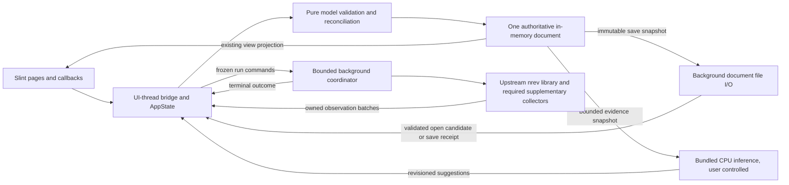

# Proposed backend architecture and data

Status: recommendation for discussion, shaped by the confirmed cross-platform and AI direction
in [the decision register](backend-decisions.md). No new modules, types or dependencies are
approved or created by this document. Names below describe responsibilities, not a mandatory
file tree or a request for one trait per component.

## Retain the current application boundary

Use one Rust desktop process. Keep Slint, the existing `Bridge`, reusable forms, card-based map,
selection and pure network model. Integrate the upstream nrev library around those boundaries;
do not introduce a web service, plugin framework, generic repository layer or second inventory.
The user's hard boundary also excludes bundled child executables, external scanner/model
programs, localhost servers and separately installed helper services. Rust/native dependencies
must execute in process and ship within the app. Normal OS APIs and communication with selected
network targets remain the collection boundary, not an externally hosted application backend.
Use normal Cargo dependency updates, with no maintained fork or copied scanner. See
[the engine contract and Windows dependency obstacle](backend-scanner-engine.md). The app
owns run lifetime and observation admission; nrev supplies implemented scanning and probes.

Cross-thread arrows carry owned messages; calls within the UI thread remain ordinary Rust
calls. Keep the authoritative document in `AppState`, extending today's ownership. Pure model
functions validate bounded observation batches and manual edits on that thread; Slint only
presents their projection. Workers own I/O tasks, temporary parse data and immutable snapshots,
never a second editable inventory. Parsing, full import validation, file serialisation and AI
stay off the event loop. A validated Open candidate is installed in one short UI transition.

For roughly 250 devices this is the simpler initial recommendation: it preserves immediate
editing and avoids edit acknowledgements, optimistic rollback and synchronisation of two
inventories. Measure batch-application, snapshot and projection time before promising UI
latency. If measured work exceeds a frame budget after batching, reconsider ownership with
evidence rather than introducing an actor or a generic state store now.

An accepted edit marks the document dirty. Save writes a revisioned snapshot and acknowledges
which revision reached disk; newer edits remain dirty. The user selected separate, labelled
crash recovery alongside explicit saves (Q13a); it never replaces the saved document silently.

| Responsibility | Owns | Must not do |
| --- | --- | --- |
| Slint/bridge and AppState | Authoritative Rust document, selection, drafts, filters, presentation models, animation, callback conversion | Socket I/O, file serialisation or inference on event-loop callbacks |
| Coordinator | One active run initially, target validation, bounded scheduling, run ID, cancellation, method outcomes | Assume every platform/method is available or trust UI indices as identities |
| Collectors | Protocol/OS I/O and source-labelled observations | Invent missing metadata or mutate user labels |
| Pure model reconciliation | Validation of manual changes and bounded batches, identity candidates, facts, freshness, conflicts, admission | Import Slint, perform I/O, or treat AI output or a port number as verified identity |
| Document I/O | Versioned snapshots, validation/migration, reliable Open/Save/Save As and separate recovery | Hold UI handles, overwrite an unsaved document silently or discard failed saves |
| AI inference | A constrained suggestion from existing evidence and a bundled pretrained model | Send probes, execute commands, change scope, merge identities or override user policy |

Route manual edits, observations and AI/admission policy through the same UI-owned model before
projection, so collection/inference cannot apply an obsolete policy. Persistence has its own acknowledgement. Keep
`Rc<RefCell<AppState>>`, `ModelRc`, images and all Slint mutation on the UI thread. Send
owned Rust data through bounded channels. Wake the event loop using the pinned Slint API,
then drain bounded batches and reuse `view::sync`; avoid one queued closure per packet.
Slint's [1.18.1 event-loop API](https://docs.rs/slint/1.18.1/slint/fn.invoke_from_event_loop.html)
and [weak-handle API](https://docs.rs/slint/1.18.1/slint/struct.Weak.html) support this boundary.

The scheduled closure must be `Send`; it cannot capture today's `Rc<RefCell<AppState>>`.
Extending the existing UI-side Slint timer to drain a receiver with a bounded item/time budget
is a simple initial option. Cross-thread wake-ups carry only thread-safe notification data
or weak handles. Slint's [spawn_local](https://docs.rs/slint/1.18.1/slint/fn.spawn_local.html)
does not provide a Tokio runtime; network I/O needs its explicitly owned background runtime.
Worker command enqueueing must not block: surface a full/closed queue and preserve local
edits. Ordinary manual edits need no worker round trip. Keep UI-thread reconciliation small;
expensive matching can propose candidates on a worker, checked against the current revision.

## Data model: extend existing concepts

The immediate requirement is trustworthy facts and user ownership, not an exhaustive network
ontology. Use owned strings for runtime metadata and std/ipnet address types. Retain existing
device/card newtypes at the domain boundary; representation changes must preserve UI identity.

| Concept | Minimum information and invariant |
| --- | --- |
| Network scope | Durable user-recognised network/context; collector interface and optional VLAN/route context; identical private prefixes can exist in different scopes |
| Device and card | Durable local keys independent of IP/MAC; device owns cards, guest ownership remains a distinct relationship |
| Address observation | IP, scope, card association if supported, observation time/source; optional prefix only when actually known; preserve an extension path for deferred IPv6 zones/multiple addresses |
| Evidence | Field/value, source/method, target/context, observed time and expiry/staleness; last success separate from latest collection outcome |
| User overlay | Explicit optional display name, role, icon, notes, manual card/service/topology assertions; clearing an override returns to observed fallback |
| Service endpoint | Scoped address, transport and port; open/closed/no-response/not-tested outcome; protocol/product evidence separate from a conventional port-name hint |
| Relationship | Endpoints, relationship kind, source, time and certainty; physical adjacency, routed reachability and guest hosting are different claims |
| Run/result | Non-reused run ID, stable result key, frozen scope/options, lifecycle, stage counters, method failures and final outcome |
| AI suggestion | Proposed field/value, supporting evidence, model/version, uncertainty and policy decision; never substitutes for observation provenance |

Avoid a new wrapper/type for every cell. These are schema obligations to refine after answers,
not a pre-approved list of Rust structs. Use a small typed collection outcome where relevant:
not queried, unavailable/unsupported, denied, timeout, malformed response, success with value,
or success with a meaningful negative result. A timeout is not proof a host or service is absent.

Validation must cover mutations as well as Open: today's `Network::device_mut` and mutable card
access permit direct field changes outside `set_card_address`. Future collectors, imports and
manual edits should pass through the same validated reconciliation commands before accepting
a revision. Preserve the prototype's interfaces until that integration is authorised; an
extra validation framework is not required by this finding.

## Identity and reconciliation

Allocate document-local IDs, persist their non-reuse allocator and map them to bounded `i32`
UI handles instead of casting persistent IDs into Slint integers. Save/open documents do not
alone require UUIDs; merging independently edited inventories might. The current IDs are `u32`, while
the bridge uses signed `i32` and `-1` for no selection.

Recommended matching order:

1. Explicit user-confirmed association within the relevant network context.
2. Consistent stable identifiers supplied by a trusted source, scoped to that source/network.
3. Compatible MAC evidence for an interface within the same link context, checked against
   simultaneous conflicts, address history and fresh observations.
4. Names, OUI vendor, service signatures and AI classification as supporting hints only.

A DHCP address change can continue the same card's history when evidence agrees. Reuse of an
IP by a different MAC must not transfer another device's notes. Repeated service announcements
or retries upsert evidence, not new devices. Same-subnet addresses on two VPNs do not collide.
Routed hosts can remain unidentified without MACs. MAC randomisation means even MAC continuity
is conditional; [Apple documents rotating private Wi-Fi addresses](https://support.apple.com/en-gb/102509).

Keep ambiguous matches in review. Proposed manual association/merge corrections should preserve
provenance and support undo; a simple association history can suffice without event sourcing.
Never infer VM/container ownership from an OUI or IP proximity. Manual ownership is already
useful; authenticated platform integrations are a separate enhancement.

## Field precedence and topology

Field precedence: explicit user overlay → current best supported observation → clearly labelled
inferred/AI fallback → unknown. The latest user answer is **manual is king** (Q10a): neither AI
nor incoming observations silently replaces manual values. AI primarily assists first-time
devices. An observed IP and a user's intended IP remain different facts. Keep display labels
separate from protocol hostnames; an AI guess retains its provenance even when applied.

For Q9, the user asked for a way to alert them when values disagree. Proposed design: show a
persistent warning on the affected existing device/card field and a compact marker in its
existing row. Details compare “Your value” and “Detected value”, with source and observation
time. Offer explicit Keep my value / Use detected value actions; the latter is a user edit,
not permission for later automatic replacement. Deduplicate by field and differing value so
refreshes update the warning instead of repeatedly opening dialogs. Keeping an assertion does
not delete contrary evidence or make it verified. Mark acknowledged differences unobtrusively;
alert again if the observed value changes. Exact presentation remains a proposal, not UI work.

Before presenting an address mismatch as a field conflict, establish whether the evidence
belongs to the same device. Ambiguous IP reuse stays in identity review; it must not attach
another host's observations to this one. A manually documented address never expands scan
scope automatically. All these edits remain local inventory, not equipment configuration.

OS family is a separate inferred/observed field, not a role or device kind. In the user's
example, `DESKTOP-13123` plus a reachable RDP endpoint may suggest “Windows PC”; store the
hostname, port/protocol evidence and OS/type suggestion separately. Neither the name nor an
open port alone verifies Windows. The current model has no OS-family field; adding truthful
inference/review presentation is an intentional future capability, not an existing feature.

Retain all supported relationship evidence, but project a deterministic, acyclic tree into
today's map. The user confirmed retaining this inferred view and deferring managed topology
(Q14). Prefer explicit manual display choices, then supported adjacency, then labelled
inference; retain unrepresented/conflicting edges rather than silently dropping their meaning.
An inferred gateway link means plausible reachability, not a physical cable. Do not add a graph
crate or replace the layout until approved physical-topology requirements need it.

## Native documents: Open, Save and Save As

The user explicitly requires save files and opening files and has selected **versioned JSON
with explicit saves** (Q22b). Use Serde/serde_json with one in-memory
document as authority. It fits explicit Save/dirty-state semantics and reuses the current
in-memory model. A private auto-updating SQLite catalogue is not a substitute for user files.
Do not add both JSON and a database as competing stores of the same inventory.

The document should carry its schema version, ID allocator, network contexts, devices/cards,
current address/service/evidence snapshots with timestamps, user labels/notes/icons, roles/groups,
manual and inferred relationships, and map arrangement. Decide per-document AI policy in Q10b.
Do not serialise Slint handles, pixel animation state, running tasks, credentials or bundled
model weights. Treat previously online devices as last-known observations on reopening, not
current reachability. Map pan/zoom and panel sizes are a separate preference decision.

Use a stable native extension after Q22a; the extension is not validation. Open reads into a
candidate document, bounds file size/record counts/strings, validates schema and cross-record
references, migrates supported older versions, then replaces the active document only after
unsaved changes are handled. Unknown newer formats, corrupt data and failed migrations leave
the current document intact. Never execute file contents, follow embedded remote references,
load database extensions or automatically resume scans because a file requests it.

Validation includes unique device/card keys, valid ownership/references, at least one card per
device, acyclic guest ownership and an acyclic display tree with at most one upstream per card.
The current constructor does not enforce these conditions and rootless card cycles disappear
from layout. Revalidate discovered endpoints at admission against the latest document revision;
do not copy a whole fixture device because one card matched the selected target.

Save writes a complete snapshot to a sibling temporary file, finishes/flushes it and uses a
vetted platform-aware replacement implementation. Keep the previous destination on failure,
surface conflicts with another writer and acknowledge success only after replacement. Save As
changes the active path only after success. Cancellation of a picker/save leaves the document
unchanged. An Open/close action with dirty edits needs Save/Discard/Cancel; inference and scans
must not race a document switch. A new document generation invalidates old callbacks/results.

Store safe relative icon identifiers and use built-in fallbacks when an icon is unavailable.
The user deferred custom-icon saving (Q22c): embedding icons or copying companion folders is
not an initial requirement. A map must still open with a fallback; do not make an absolute
build-machine icon path a document dependency.
Native file pickers must use in-process APIs/normal desktop integration, never launch another
program. Extension, saved views/history and multi-writer conflict policy remain Q13/Q22a.

Serialise saves to the same destination: an older snapshot finishing after a newer one must
not replace newer saved content. Each receipt identifies document generation, revision and
destination, so an old Save or Save As cannot change a newly opened document's path/dirty state.
Cancelling a picker or switching documents does not undo a replacement that already committed;
finish or account for that save explicitly. Recovery writes use their own destination.

User-selected document paths are distinct from per-user preferences and the requested crash
recovery snapshot. Recovery must be labelled unsaved, respect the same validation, and never
silently overwrite a user's saved document. Network credentials belong in OS credential storage,
not portable documents. Opened files carry no authority to enable scanning, AI automation or
auto-add without the local user's policy.

If later history/scale requirements justify SQLite, consider a single documented SQLite-native
document or a subordinate rebuildable history store, not duplicate inventory authority. A
SQLite format needs explicit Save semantics, consistent snapshot/backups and migration policy;
[its online backup API](https://www.sqlite.org/backup.html) avoids casually copying a live
database with journal/WAL state. The [crate research](backend-crates.md) records that alternative.
Neither JSON nor SQLite is encrypted by being local. Storage/retention expectations remain Q12.

## Updates, lifetime and resource limits

Scope every event to a run/network generation. Reject stale results after cancellation,
target changes, deletion or shutdown. Address changes update evidence, not list-index-based
selection. Take user edits as revisions so older enrichment cannot restore deleted overlays.

Use Tokio for bounded asynchronous network I/O; a single coordinator can own a runtime on
background thread(s). Keep file I/O and blocking OS/library calls off both Slint and async I/O
workers. Bound sockets, per-host work, parser sizes, queues, log length and retained evidence;
do not create a task for every host-port pair of a large range. A semaphore limits simultaneous
work; a separate rate limit controls packet/connection start rate.

Coalesce replaceable progress updates. Deliver accepted observations and terminal outcomes
reliably; if a collector overflows, report lost coverage and re-observe within authorised scope.
Throttle GUI projection (a proposed 5–10 batches/second) while retaining final state. These
are starting points to measure, not demonstrated performance figures.

The user selected manual broad scans and optional lightweight refresh (Q5). Prefer protocol
TTLs, small directed refreshes of known endpoints, cached name results and network-change
invalidation over repeated broad scans. Refresh is opt-in; exact cadence and traffic budget
remain Q5a. Missing responses make evidence stale/unknown unless an agreed
policy supports a stronger offline conclusion. Link loss invalidates that scope's current
reachability without declaring every device globally offline.

Cancellation needs an independent token/control path so a full result queue cannot prevent
Stop. After signalling, supervise all owned tasks and acknowledge one terminal outcome;
ignore late batches by generation. A started blocking call cannot be killed by dropping a
Tokio handle. Persistent blocking storage/inference workers need bounded admission and an
explicit shutdown contract; no unconditional wait on an unbounded native call.
