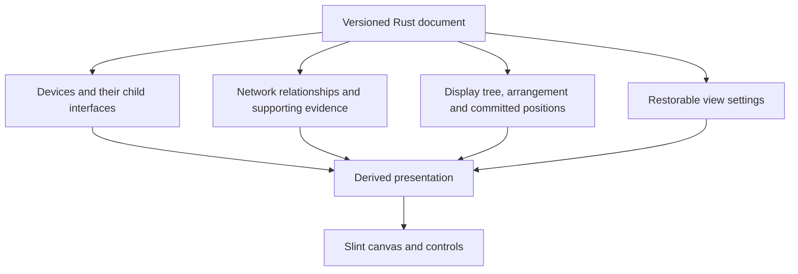

# Map persistence, custom trees and UI choice

20 October 2026. Documentation-only review of the current placement code. No persistence,
free-positioning mode or framework replacement has been implemented or tested here.
The general document lifecycle remains in [the architecture](backend-architecture.md#native-documents-open-save-and-save-as).

## Confirmed direction

- Save the complete map, including positions, relationships and arrangement, within the
  agreed versioned JSON document; retain the wider **save everything** requirement.
- A custom display tree organises the map **separately from network connections**. Moving
  a node under another node does not assert that those interfaces are connected.
- Moving a parent in the future free-positioning mode moves its entire displayed branch.
  Descendants are determined by the display tree, not device ownership or network links.
- Preserve the existing automatic tree, tier ordering, snapping and animation where they
  fit these rules. Free positioning is requested future behaviour, not an existing feature.
- Windows, Linux and macOS remain required. Keep shared Rust logic and upstream platform
  integration; unavoidable platform exceptions still need the user's explicit approval.

## What the code already does

| Existing area | Finding and consequence for saving |
| --- | --- |
| [Card tree](../src/model/network/tree.rs) | Map nodes are `CardId` interfaces drawn with their device's icon/name. A device can therefore have several map icons. Save device ownership and card identity, not just icon names or IP addresses. |
| [Arrangement](../src/model/arrangement.rs) | Per-parent tiers contain ordered left/right card lists. These express branch placement that coordinates alone cannot explain. Unarranged children fall back to network connection order. |
| [Layout](../src/model/layout.rs) | `tree_layout` calculates icon centres in map units: one unit equals one logical pixel at 100% zoom. Root order currently follows device/card order. Save explicit root order and arrangement rather than relying on hash iteration or incidental inventory order. |
| [Snapping](../src/model/snap.rs) | Dragging chooses a trunk, tier, side and neighbour. Those committed choices are meaningful; temporary snap candidates are not. |
| [Drop handling](../src/ui_bridge/map/drag.rs) | A drop currently calls `Network::connect`, updates `Arrangement`, then lays out the map again. This couples visual reparenting to network links and does not retain arbitrary dropped coordinates. It needs a different contract for the confirmed separation. |
| [Map bridge](../src/ui_bridge/map.rs) and [initialisation](../src/ui_bridge.rs) | `lay_out` replaces positions with calculated positions; initialisation starts with an empty arrangement. Merely adding coordinate serialisation would still allow normal initialisation or later edits to overwrite restored placement. |
| [Motion](../src/ui_bridge/map/motion.rs) | Shown coordinates, spring velocities and preview movement are animation state. Save committed target placement, then initialise animation at rest on Open. During a drag even `AppState.positions` contains temporary pointer placement, so it is not yet a safe save snapshot by itself. |
| [Canvas](../ui/topology-canvas.slint) | Pan, zoom and auto-fit currently live in Slint. Complete saves need these restorable values captured into the Rust document snapshot, with restoration coordinated with viewport creation. |
| [Line drawing](../src/ui_bridge/map/lines.rs) | SVG commands, trunks, shared branch junctions and selected-device ties are generated. A line joining another line is not another network connection. Save their underlying relationships/styles, then regenerate drawing commands. |

There is valuable reusable placement behaviour here. The missing piece is durable map state
with clear meaning, rather than a replacement drawing toolkit. Older reset hooks in source
are prototype behaviour; they do not override the confirmed absence of a Reset feature.

## One document, three distinct relationships

Device ownership answers which machine owns an interface. Network relationships describe
observed, inferred or manually asserted connectivity with provenance. Display parentage
answers which icons move and arrange together. VM/container host ownership is another
inventory relationship already present in the model; it is not a substitute for display
parentage either.

For example, an access point may remain network-connected to a switch while the user puts
it under a different icon for presentation. Saving and reopening must preserve both facts.
A display parent must never turn into a `Known` network link simply because it was dragged.

Use a single explicit display forest referencing existing card IDs. It may initially be
generated from the inferred network tree, but thereafter it is saved presentation state.
Record whether placement was generated or user-arranged so later discovery can respect
manual choices. Do not introduce duplicate device/interface records or a general scene
graph framework merely to hold the display tree.

The existing `Arrangement` structure can provide ordered tiers and sides, but it currently
filters against `Network::behind`. Its future input must be display parentage for custom
trees. Tree traversal, snapping, branch movement and tree-line routing must all use the same
display relationships. Separate rendering of actual network relationships must use network
evidence and must not disguise organisational branches as verified connectivity.

## Proposed saved map contract

This is a schema contract for discussion, not final JSON field names or new Rust types.
Keep it in the same authoritative document as the inventory, serialised with
[Serde](https://serde.rs/) and JSON as already proposed.

| Saved information | Purpose |
| --- | --- |
| Schema version, durable device/card IDs and allocation state | Reopen relationships without relying on array indices, UI row handles, changing IPs or reused IDs. |
| Inventory ownership and all supported network relationships with provenance | Preserve what belongs to what and what is known about connectivity independently of appearance. |
| Display parent for each non-root card, ordered roots and generated/user-arranged origin | Restore the displayed branch structure and respect manual choices during later reconciliation. A root has no display parent. |
| Ordered tiers and left/right siblings for each display parent | Retain the existing automatic-tree arrangement and deterministic snap placement. Store ordered arrays, not unordered sets. |
| Committed icon-centre `x/y` for every displayed card | Reopen the same logical placement, including custom positions, without immediately rerunning a possibly changed layout algorithm. |
| Placement policy and layout algorithm/version/parameters | Distinguish automatic arrangement from manually maintained coordinates. Decide explicitly which operations may recalculate which positions. |
| View centre in map coordinates, zoom and auto-fit preference | Restore the user's view across differing window sizes and display scaling. Capture target values rather than an intermediate animation frame. |
| Existing icon choices, label/view options, group colours, line styles, panels and restorable selection/filter state | Fulfil complete-state saving; preserve custom asset references under the separate asset-packaging decision. |

Store **absolute map coordinates** initially. Parent-relative transforms would add another
coordinate system without an established need. A branch move applies the same map-space
delta to its parent and all displayed descendants, preserving their offsets. This is one
committed edit, even when many icons move.

Arrangement and coordinates are complementary, with defined authority: the committed
coordinates restore the current picture; the ordered tree/tier intent drives a future
permitted automatic layout operation. A layout operation updates its calculated coordinates
in the same document edit. In free positioning, coordinates remain authoritative and ordinary
refreshes or inventory edits must not run an unrestricted `tree_layout` over them. Do not
maintain separate independently editable copies in Slint and Rust.

The simplest proposed distinction is automatic tree placement versus free positioning.
Mixed pinned/automatic nodes, several named views and non-card grouping boxes are **not
approved requirements**. Do not add them pre-emptively. Mode switching and its effect on
existing positions still need an agreed user-facing rule.

Saving during a drag should use the last committed map revision, not half a branch move or
temporary room-making positions. Dropping commits display parentage/order/coordinates
together; cancelling restores that revision. Saving during settling animation need not wait
for the springs. Retain all meaningful project/history state under the complete-save policy;
pointer capture, hover, runtime handles and animation velocities are not restorable project
content. Persistent undo history, if desired, needs its own explicit format decision.

## Open, reconciliation and drawing

Validate a candidate before replacing the current document: unique IDs, existing references,
valid ownership, finite bounded coordinates/zoom, and a display forest with no cycles or
multiple parents. Check that ordered roots and tier lists agree with display parentage and
contain no duplicate placements. Do not apply the display-forest restriction to future
network evidence that can legitimately contain redundant links or loops.

Restore the saved arrangement and committed coordinates, initialise motion at those positions
and regenerate paths. Restore the viewport after its dimensions are known; initial auto-fit
must not overwrite a saved manual view. Retaining map-space view centre is more portable
than raw screen pan offsets. An explicitly saved auto-fit preference can intentionally fit
the restored map to the new window. Font metrics/rasterisation can vary across operating
systems even when icon centres and relationships are identical.

Discovery and AI updates must not silently move a user-arranged branch or replace its display
parent. Keep missing/offline devices and their placement. A new admitted card needs initial
placement without moving existing manually positioned icons; a separate clear area is a
proposed default, not a settled interaction. Identity merges must reconcile layout references
explicitly; an IP match alone cannot transfer a saved position to a different machine.

The existing router assumes downward tree geometry and shared tier buses. Arbitrary positions
can put a child above its parent or make lines cross icons, so free placement also needs a
defined routing policy. Preserve the current router for supported tree arrangements; do not
claim it already provides general obstacle avoidance. Generated paths remain derived data.
If editable bends or junctions are later approved, their stable IDs and user control points
become saved state; do not serialise every renderer-generated SVG string as the source of truth.

## Supporting systems and Slint assessment

**Recommendation: keep Slint for the current product.** The existing Rust layout, snap logic
and Slint components already implement the interaction style being preserved. Slint supplies
[vector paths](https://docs.slint.dev/docs/slint/reference/elements/path/) and
[transforms](https://docs.slint.dev/docs/slint/reference/common/#transforms), and its
[Winit backend](https://docs.slint.dev/docs/slint/guide/backends-and-renderers/backend_winit/)
supports Windows, macOS and Linux/X11/Wayland. This is a suitability judgement based on source
and documentation, not a measured claim that Slint is the fastest or best toolkit for every
graph editor. A framework change would still require the same document and relationship design.

| System | Fit and recommendation |
| --- | --- |
| Serde/serde_json and vetted file replacement | Planned shared Rust document persistence. Keep file lifecycle, migrations and validation outside Slint. JSON serialisation alone does not supply atomic replacement or crash recovery. |
| Existing tree layout, snapping and animation | Reuse these for the current style, adapting their relationship input. A generic layout engine need not reproduce the existing tier/bus appearance. |
| [petgraph](https://docs.rs/petgraph/latest/petgraph/) | Established graph structures/algorithms if future topology requires them. Not needed just to save today's display forest; library node indices must not replace durable project IDs. |
| [rstar](https://github.com/georust/rstar) | Rust spatial index, a candidate if measured hit testing, nearest-line lookup or viewport queries become expensive. It does not save maps or lay out trees; any index is rebuildable. |
| [ELK Rust port](https://docs.rs/elk-layout/latest/elk_layout/) | Possible research candidate for more complex graph layout/routing. Not selected or qualified for this app's toolchain, behaviour or maturity; no Java/JavaScript runtime or external layout executable is authorised. |
| [egui](https://github.com/emilk/egui) with [egui-snarl](https://github.com/zakarumych/egui-snarl) | Credible Rust alternative for a product centred on generic node/port editing. eframe supports all three desktop platforms and snarl supplies node-graph UI. Changing to it would require replacing current UI integration and preserving this app's specific tree behaviour; it does not settle network semantics or the complete save contract. No migration recommended. |
| [Iced Canvas](https://docs.rs/iced/latest/iced/widget/canvas/index.html) | Rust custom drawing and event handling. A possible alternative canvas, but the existing nodes, interactions and UI would need porting. No demonstrated gain here justifies a rewrite. |

No additional crate is selected or added by this comparison. Ordinary Rust document edits
can also support grouped undo/redo, a useful proposal for a map editor: one branch move or
reparent becomes one reversible action. This is separate from, and does not introduce, Reset.

One concrete renderer qualification matters: this project enables `renderer-skia`. Slint's
[generic software renderer](https://docs.slint.dev/docs/slint/guide/backends-and-renderers/backends_and_renderers/#software-renderer)
currently documents no scaling/rotation support, while this canvas uses scaling. **Skia
software rendering is a different renderer option.** Do not promise any software fallback
works identically without testing it. Skia and Linux window-system runtime dependencies also
need package-level checks against the run-the-app requirement; this review neither changes
backend selection nor approves user-installed prerequisites or local compatibility patches.

Before reconsidering Slint, measure representative maps by **card/icon count**, not only the
roughly 250-device goal. Inspect layout traversal, generated path work and bridge updates
during animation as well as rendering. Verify save/reopen across differing viewport sizes,
branch movement, free routing, keyboard interaction and packaged operation on all three OSes.
These are future acceptance needs, not tests performed during this documentation review.

## Remaining map decisions

- Automatic/free placement switching: what happens to existing custom coordinates when the
  user chooses automatic placement? Proposed default: preserve the current map until an
  explicit layout action with a reviewable effect; never silently reorganise it on Open.
- How should organisational branches and actual network relationships be distinguished
  visually when they differ? Proposed default: clearly separate their meaning through
  styling and the map key; do not add an unapproved second map or new grouping-node system.
- What initial placement/routing behaviour is acceptable for newly added nodes and free
  positions? Agree examples, including above-parent placement, before selecting a router.

The custom-tree semantics and whole-branch dragging questions are answered. The points above
are narrower presentation/placement choices, not reasons to revisit those answers.
